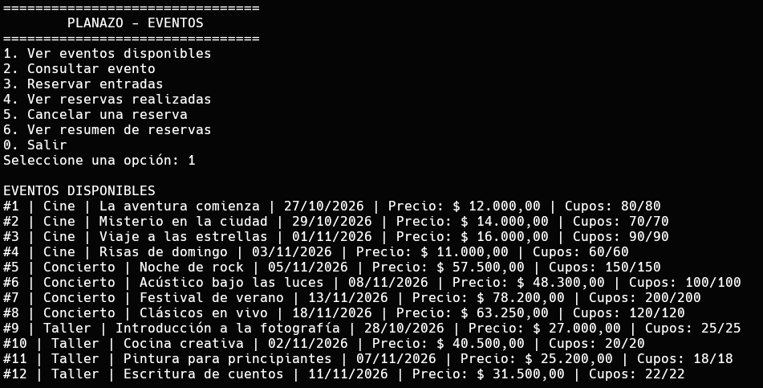
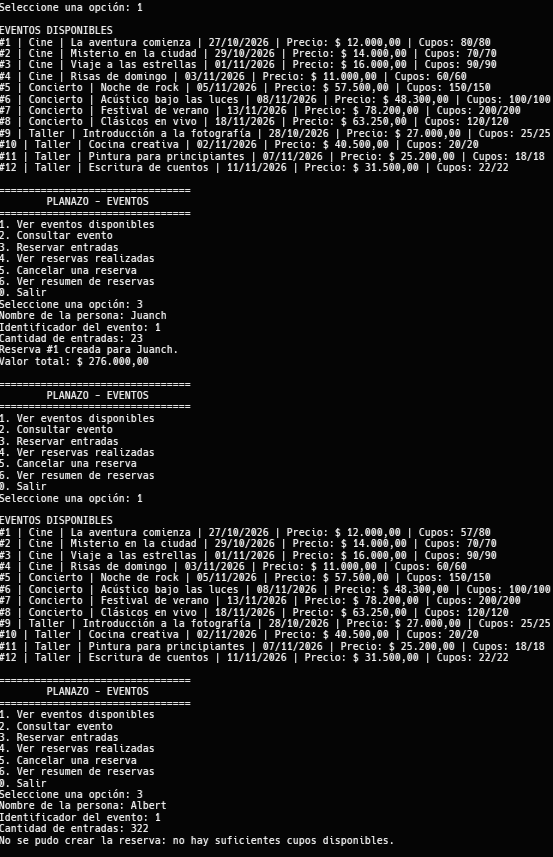

# PLANAZO - Eventos

Aplicación de consola desarrollada en C# con .NET 8 para consultar eventos, reservar entradas, controlar cupos y cancelar reservas.

## Funcionalidades

- Consulta de 12 eventos iniciales: cuatro películas, cuatro conciertos y cuatro talleres.
- Cálculo de precios según el tipo de evento: precio base para cine, incremento del 15 % para conciertos y descuento del 10 % para talleres.
- Creación de reservas con validación del nombre, cantidad de entradas y disponibilidad.
- Consulta de reservas activas y canceladas.
- Cancelación de reservas activas con devolución de cupos. Una reserva no se puede cancelar más de una vez.
- Resumen de reservas activas, entradas reservadas y valor total.
- Manejo de entradas incorrectas y errores de operación sin cerrar el programa.

## Ejecución

Se requiere tener instalado el SDK de .NET 8. Desde la carpeta del proyecto, ejecuta:

```text
dotnet run
```

El menú y los mensajes de la aplicación están en español. Los eventos de ejemplo se inicializan nuevamente cada vez que se inicia el programa.

## Clases y relaciones

- `Evento` es la clase abstracta con los datos comunes, el control de cupos y la operación `CalcularPrecioFinal()`.
- `Cine`, `Concierto` y `Taller` heredan de `Evento` y calculan su precio final de forma diferente.
- `Reserva` asocia a una persona con un evento, almacena entradas, valor y estado, y devuelve los cupos al cancelarse.
- `EventCatalog` administra la colección de eventos iniciales y permite consultarlos por identificador.
- `ReservationService` crea, consulta y cancela reservas, y calcula el resumen de las reservas activas.
- `InitialData` crea los eventos de ejemplo.
- `ConsoleMenu` gestiona la interacción con el usuario y presenta los resultados.
- `Program.cs` inicia el menú.

El catálogo contiene eventos y el servicio de reservas se asocia con el catálogo. Cada reserva, a su vez, mantiene una referencia al evento reservado. Las colecciones usan `List<T>`.

## Principios de programación orientada a objetos

- **Encapsulamiento:** las propiedades de los modelos solo permiten cambios controlados. Por ejemplo, la disponibilidad solo cambia al reservar o devolver cupos; el estado de una reserva solo cambia al cancelarla.
- **Abstracción:** `Evento` define los datos y el comportamiento comunes sin especificar cómo cada evento determina su precio.
- **Herencia:** `Cine`, `Concierto` y `Taller` reutilizan las características de `Evento`.
- **Polimorfismo:** `CalcularPrecioFinal()` se invoca mediante la referencia común `Evento` y ejecuta la regla del tipo concreto.
- **Asociación y composición:** una reserva se relaciona con el evento reservado y `ReservationService` administra las reservas del sistema.

## Verificación manual y capturas de consola

Las capturas muestran salidas de ejecuciones reales de la aplicación compilada con .NET 8.

### Eventos y precios

Al seleccionar `1. Ver eventos disponibles`, se muestran los 12 eventos y los precios calculados.



### Reservas, errores y cancelaciones

La ejecución de prueba crea una reserva válida y luego intenta superar los cupos. No hubo mas pruebas porque no cabe mas nada, tuve que hacer zoom out hasta que las letras parecian hormigas.



### Pregunta adicional

**¿Por qué utilizaste una clase abstracta `Evento` en lugar de crear clases completamente independientes para Cine, Concierto y Taller? ¿Qué ventajas tiene esta decisión cuando necesitamos agregar un nuevo tipo de evento?**

**Respuesta**: Ademas de que porque lo requeria la actividad, porque eso hace que la app sea mucho mas *escalable*. Que un proyecto o aplicacion sea escalable significa que es facilmente ampliable, agregarle funcionalidades nuevas no es extremadamente costoso ni tampoco requiere transformaciones monumentales de codigo (definicion de extremadamente costoso en codigo, vaya).

La ventaja principal es que como la clase abstracta sirve de plano o molde, al agregar un nuevo tipo de evento tienes exactamente ese molde y no tienes que repetir codigo una y otra y otra vez. Ademas que asi plasmas una relacion tipo asi: *Cine* es un tipo de *Evento*, y asi se arman las relaciones. Legibilidad de codigo etc.
